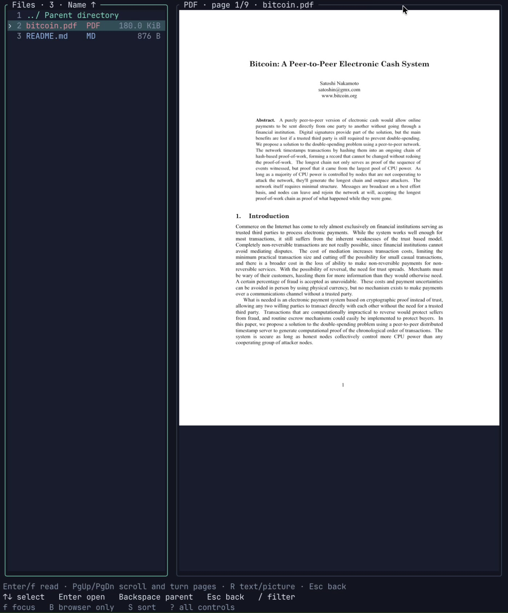
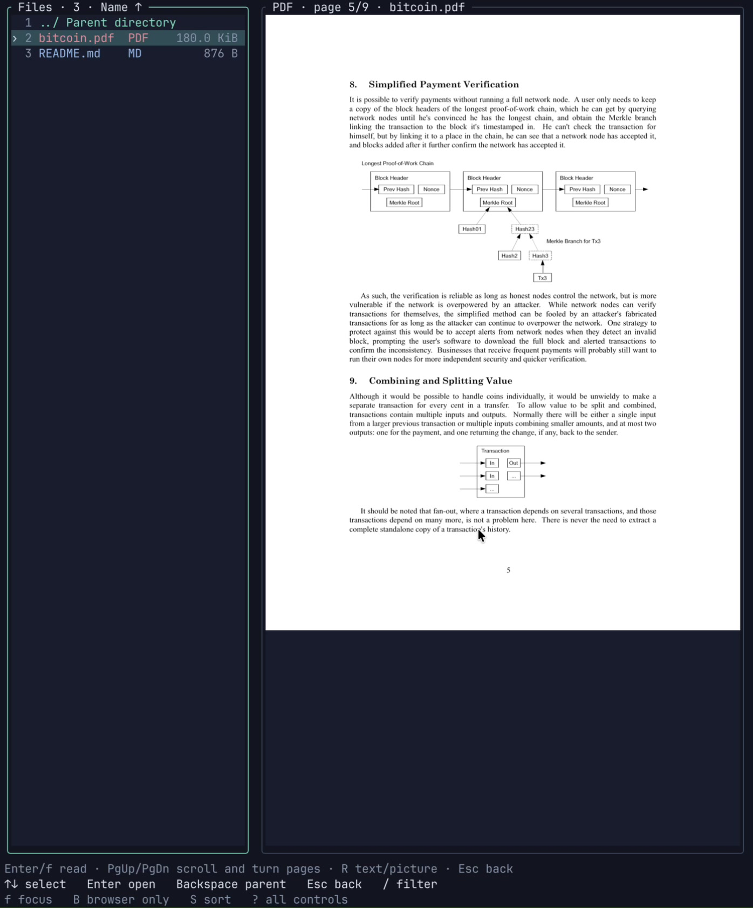

<p align="center">
  
</p>
<p align="center"><strong>Your files. In focus.</strong></p>
<p align="center">
  <a href="https://github.com/Obedience-Corp/festival"></a>
  <a href="https://github.com/lancekrogers/peep/actions/workflows/check.yml"></a>
  <a href="LICENSE"></a>
  
  
</p>

**peep is a terminal file explorer that lets you see, hear, and read your files.**
Browse a folder, preview an image, play a recording, or open an illustrated
Markdown document—without leaving the terminal.

https://github.com/user-attachments/assets/7cfbda66-c8d0-4ab9-9766-4a7b1b02f94b

*74-second demo watch with sound on.*

- **Browse** with Vim navigation, numbered jumps, sorting, fuzzy search, and globs.
- **Watch** images, animated GIFs, and videos with native terminal graphics.
- **Listen** to music and audiobooks with seeking, playback speed, and a live spectrum.
- **Read** syntax-highlighted source, Markdown with local images, Mermaid diagrams, and PDFs page by page.
- **Manage** files with rename, move, confirmed deletion, and your preferred editor.

## Get started

Choose an install method:

**Homebrew · macOS / Linux**

```sh
brew install lancekrogers/tap/peep
```

**npm · macOS / Linux** (Node 22+)

```sh
npm install -g @obedience-corp/peep
peep setup
```

**AUR · Arch Linux**

```sh
yay -S peep-tui-bin
# or: paru -S peep-tui-bin
```

Homebrew and AUR install FFmpeg and mpv for media playback and poppler for PDF
preview. With npm, `peep setup` offers to install missing tools through your
package manager. Mermaid is built in.

```sh
peep              # Browse the current directory
peep ~/Pictures   # Browse a directory (peep <path>)
peep README.md     # Preview a file
peep manual.pdf   # Read a PDF: → / ← turn pages, R switches picture and text
rg -l "TODO" | peep # Browse files matching a content search
peep --doctor     # Check media and PDF dependencies and terminal support
```

[Installation details and release archives →](docs/install.md)

<details>
<summary>Install from source</summary>

Requires **Go 1.27+** and **just**. `just install` sets up missing media and PDF tools
through your supported package manager and upgrades an active legacy Go-bin copy.
Follow the installer's PATH guidance if needed.

```sh
git clone https://github.com/lancekrogers/peep.git
cd peep
just install
peep
```

</details>

## Take a peep

The included **Night Shift** collection has original artwork, a music track,
two narrated audiobook chapters, a video, a GIF, diagrams, and an illustrated field guide.


```sh
just demo
```

This opens a disposable copy—safe for showing rename, move, and delete.
The curated files are also ready to browse in [`examples/night-shift`](examples/night-shift).
[Demo walkthrough](docs/demo.md) · [Media credits and sources](examples/night-shift/CREDITS.md)

## Read PDFs

Select a PDF to preview it, and press Enter to read it. In a Kitty-graphics terminal
each page is a real image at the width of the pane.

<p align="center">
  
  
</p>

*The Bitcoin paper from [`examples/papers`](examples/papers), in Ghostty.*

```sh
peep examples/papers/bitcoin.pdf
```

- **Scroll** with `j`/`k`, Page Up/Down, or the mouse wheel. Scrolling past the end of a page continues on the next.
- **Turn pages** with `←`/`→`, or jump with `5G`.
- **Switch to text** with `R`, then search the page with `/`.

Terminals without native graphics show each page's text instead. PDF viewing uses
poppler, which Homebrew and AUR install with peep; with npm, run `peep setup`.
[PDF guide →](docs/usage.md#pdf-previews)

## The essentials

| Key | Action |
| --- | --- |
| `j/k` or `↑/↓` · `Enter` | Select · open or play |
| `Backspace` · `Esc` | Parent folder · back |
| `/` | Filter filenames; find text inside a focused document |
| `S` | Sort by name, modified, created, size, or type |
| `f` · `v` | Focus preview · show now playing |
| `Space` · `[` / `]` | Play/pause · seek |
| `,` | Change the seek step |
| `?` · `q` | All controls · quit |

Native image quality requires a Kitty-graphics-compatible terminal. Other terminals
use color-cell previews; Mermaid stays readable as source. Audio plays on the host
running peep. [Terminal compatibility →](docs/terminal-graphics.md)

[Full user guide](docs/usage.md) · [Development](docs/development.md) · [Architecture](docs/architecture.md)

[MIT license](LICENSE) · [Distribution and release setup](docs/distribution.md)
